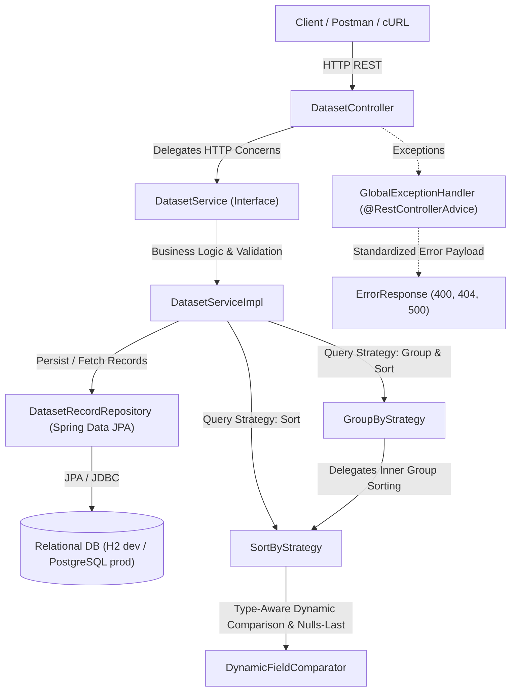

# Dynamic JSON Dataset REST API

A production-quality Spring Boot 3 REST API that stores arbitrary JSON records per dataset in a relational database, and enables dynamic querying with arbitrary `groupBy` and `sortBy` parameters.

---

## Live Demo

- **Live API Base URL**: `<to be added>`
- **Interactive Swagger UI**: `<to be added>` *(e.g., `https://<your-render-url>/` or `https://<your-render-url>/swagger-ui.html`)*
- **Health Check Endpoint**: `<to be added>/actuator/health`

---

## Overview

Modern data platforms frequently ingest disparate, evolving JSON payloads across distinct datasets. This service provides a schema-agnostic relational persistence engine:
- Ingests arbitrary, valid, non-empty JSON objects into dynamically named datasets.
- Persists payloads into a single relational table using a native `TEXT` column (avoiding PostgreSQL OID/CLOB pitfalls).
- Executes flexible queries with on-the-fly `groupBy` and `sortBy` operations using the **Strategy Pattern**.
- Implements comprehensive error handling returning uniform, RFC-compliant JSON error bodies.

---

## Architecture & System Design

The application follows a clean layered architecture adhering to SOLID design principles, constructor-only dependency injection (no field injection), and strict separation between persistence entities and transfer DTOs.



### Package Structure
```
com.assignment.dataset
├── DatasetServiceApplication.java     # Application bootstrapper
├── config
│   ├── DatabaseUrlConverter.java      # Converts Render postgres:// URLs to JDBC with SSL & + decoding
│   ├── HomeController.java            # Redirects root URL '/' directly to '/swagger-ui.html'
│   ├── JacksonConfig.java             # ObjectMapper & JavaTimeModule configuration
│   ├── OpenApiConfig.java             # OpenAPI 3 / Swagger documentation configuration
│   ├── ProdDataSourceConfig.java      # PostgreSQL Hikari pool tuned for 512 MB memory limits
│   └── SampleDataSeeder.java          # Automatic demo data restoration (SEED_SAMPLE_DATA=true)
├── controller
│   └── DatasetController.java         # REST endpoints (HTTP concerns only, no business logic)
├── dto
│   ├── DatasetQueryResponse.java      # Query DTO (records, sortedRecords, groupedRecords)
│   ├── ErrorResponse.java             # Standardized error payload
│   └── RecordCreateResponse.java      # 201 Created confirmation DTO
├── entity
│   └── DatasetRecord.java             # JPA Entity mapped to table `dataset_record` (TEXT column)
├── exception
│   ├── DatasetNotFoundException.java        # 404 Not Found
│   ├── FieldNotFoundException.java          # 400 Bad Request
│   ├── GlobalExceptionHandler.java          # Centralized @RestControllerAdvice
│   ├── InvalidDatasetNameException.java     # 400 Bad Request
│   ├── InvalidQueryParameterException.java  # 400 Bad Request
│   └── InvalidRecordException.java          # 400 Bad Request
├── repository
│   └── DatasetRecordRepository.java   # Spring Data JPA Repository
├── service
│   ├── DatasetService.java            # Business logic contract
│   └── DatasetServiceImpl.java        # Service implementation with validation & transaction boundaries
└── strategy
    ├── DynamicFieldComparator.java    # Numeric, String, Boolean & Nulls-Last comparator
    ├── GroupByStrategy.java           # Grouping strategy with optional group-level sorting
    ├── SortByStrategy.java            # Sorting strategy with field-existence validation
    └── SortOrder.java                 # Enum representing ASC and DESC
```

---

## Tech Stack

| Technology | Purpose |
|---|---|
| **Java 17+** (Eclipse Temurin) | Core programming language runtime |
| **Spring Boot 3.3.5** | Core framework, dependency injection, and configuration |
| **Spring Web (Spring MVC)** | RESTful controllers, routing, and HTTP message conversion |
| **Spring Data JPA & Hibernate** | Relational data persistence and entity mapping |
| **Jackson ObjectMapper** | Dynamic serialization/deserialization of JSON records to `Map<String, Object>` |
| **PostgreSQL JDBC Driver** | Production database connectivity (Render / Cloud) |
| **H2 Database (In-Memory)** | Zero-setup development and test database |
| **Spring Boot Actuator** | Health probe endpoint (`/actuator/health`) for cloud monitoring |
| **springdoc-openapi 2.6.0** | Interactive OpenAPI 3 / Swagger documentation UI |
| **JUnit 5, Mockito & AssertJ** | Comprehensive unit, WebMvc, DataJpa, and slice testing |
| **Testcontainers PostgreSQL** | Integration testing against real `postgres:16-alpine` |
| **Docker** | Multi-stage, unprivileged non-root containerization |

---

## Prerequisites & Running Locally

### Prerequisites
- **Java**: JDK 17 or 21+
- **Maven**: 3.8+ (or system Maven wrapper)
- **Docker**: Optional (required only for running PostgreSQL Testcontainers tests)

### 1. Run All Tests
```bash
mvn clean test
```
Executes all unit, repository, controller, and strategy tests. Tests run against the in-memory H2 database by default.

### 2. Run Locally in Development Mode
```bash
mvn spring-boot:run
```
The application starts immediately on port `8080` with zero database setup.
- **Root URL**: [http://localhost:8080/](http://localhost:8080/) *(automatically redirects to Swagger UI)*
- **Interactive Swagger UI**: [http://localhost:8080/swagger-ui.html](http://localhost:8080/swagger-ui.html)
- **OpenAPI JSON Spec**: [http://localhost:8080/v3/api-docs](http://localhost:8080/v3/api-docs)
- **H2 Web Console**: [http://localhost:8080/h2-console](http://localhost:8080/h2-console)
  - JDBC URL: `jdbc:h2:mem:datasetdb`
  - Username: `sa`
  - Password: *(leave empty)*
- **Health Check**: [http://localhost:8080/actuator/health](http://localhost:8080/actuator/health)

---

## API Documentation & Endpoints

### 1. Insert Record
`POST /api/dataset/{datasetName}/record`

Persists any valid, non-empty JSON object into the specified dataset.
- If the body contains its own `"id"` field, it is kept inside the stored JSON untouched.
- The returned `recordId` is the database-generated auto-incrementing primary key.

#### Request Headers
```http
Content-Type: application/json
```

#### Sample Request Body
```json
{
  "id": 1,
  "name": "John Doe",
  "age": 30,
  "department": "Engineering"
}
```

#### Success Response (`201 Created`)
```json
{
  "message": "Record added successfully",
  "dataset": "employees",
  "recordId": 1
}
```

---

### 2. Query Dataset Records
`GET /api/dataset/{datasetName}/query`

Query records dynamically with optional grouping and sorting.

#### Query Parameters
| Parameter | Type | Required? | Default | Description |
|---|---|---|---|---|
| `groupBy` | String | No | None | Field name to group records by. |
| `sortBy` | String | No | None | Field name to sort records by. |
| `order` | String | No | `asc` | Sort direction: `asc` or `desc` (case-insensitive). |

#### Query Modes & Success Responses (`200 OK`)

1. **Default (Neither `groupBy` nor `sortBy` specified)**:
   ```json
   {
     "records": [
       { "id": 1, "name": "John Doe", "age": 30, "department": "Engineering" },
       { "id": 2, "name": "Jane Smith", "age": 25, "department": "Marketing" }
     ]
   }
   ```

2. **Sort Only (`?sortBy=age&order=asc`)**:
   ```json
   {
     "sortedRecords": [
       { "id": 2, "name": "Jane Smith", "age": 25, "department": "Marketing" },
       { "id": 1, "name": "John Doe", "age": 30, "department": "Engineering" }
     ]
   }
   ```

3. **Group Only (`?groupBy=department`)**:
   ```json
   {
     "groupedRecords": {
       "Engineering": [
         { "id": 1, "name": "John Doe", "age": 30, "department": "Engineering" }
       ],
       "Marketing": [
         { "id": 2, "name": "Jane Smith", "age": 25, "department": "Marketing" }
       ]
     }
   }
   ```

4. **Group and Sort Combined (`?groupBy=department&sortBy=age&order=asc`)**:
   Groups first by `department`, then sorts records inside each group by `age` in ascending order.
   ```json
   {
     "groupedRecords": {
       "Engineering": [
         { "id": 1, "name": "John Doe", "age": 30, "department": "Engineering" },
         { "id": 3, "name": "Bob Johnson", "age": 35, "department": "Engineering" }
       ],
       "Marketing": [
         { "id": 2, "name": "Jane Smith", "age": 25, "department": "Marketing" }
       ]
     }
   }
   ```

---

### Error Responses

Every error returned by the global exception handler (`GlobalExceptionHandler`) adheres to a consistent JSON structure:

```json
{
  "timestamp": "2026-11-19T06:30:00Z",
  "status": 400,
  "error": "Bad Request",
  "message": "Field 'salary' does not exist in the dataset.",
  "path": "/api/dataset/employees/query"
}
```

#### HTTP Status Codes
| Status | Error Reason | Typical Cause |
|---|---|---|
| **400 Bad Request** | `InvalidRecordException` | Empty JSON request body (`{}`), null body, or JSON array instead of object. |
| **400 Bad Request** | `HttpMessageNotReadableException` | Malformed JSON syntax (unclosed quotes, trailing commas, non-JSON text). |
| **400 Bad Request** | `InvalidQueryParameterException` | `order` parameter is not `asc` or `desc` (e.g., `order=random`). |
| **400 Bad Request** | `FieldNotFoundException` | `groupBy` or `sortBy` field does not exist in any record across the dataset. |
| **400 Bad Request** | `InvalidDatasetNameException` | Blank dataset name, illegal path traversal, or special characters. |
| **404 Not Found** | `DatasetNotFoundException` | Querying a dataset that does not exist or has 0 records. |
| **404 Not Found** | `NoResourceFoundException` | Calling an undefined API path. |
| **500 Internal Server Error** | `Exception` | Unhandled runtime exception (generic safe message returned). |

---

## cURL Examples

### 1. Insert Records
```bash
# Record 1: John Doe (Engineering, Age 30)
curl -X POST "http://localhost:8080/api/dataset/employees/record" \
  -H "Content-Type: application/json" \
  -d '{"id": 1, "name": "John Doe", "age": 30, "department": "Engineering"}'

# Record 2: Jane Smith (Marketing, Age 25)
curl -X POST "http://localhost:8080/api/dataset/employees/record" \
  -H "Content-Type: application/json" \
  -d '{"id": 2, "name": "Jane Smith", "age": 25, "department": "Marketing"}'

# Record 3: Bob Johnson (Engineering, Age 35)
curl -X POST "http://localhost:8080/api/dataset/employees/record" \
  -H "Content-Type: application/json" \
  -d '{"id": 3, "name": "Bob Johnson", "age": 35, "department": "Engineering"}'
```

### 2. Query All Records (Default)
```bash
curl -X GET "http://localhost:8080/api/dataset/employees/query"
```

### 3. Query Group By Department
```bash
curl -X GET "http://localhost:8080/api/dataset/employees/query?groupBy=department"
```

### 4. Query Sort By Age Ascending
```bash
curl -X GET "http://localhost:8080/api/dataset/employees/query?sortBy=age&order=asc"
```

### 5. Query Sort By Age Descending
```bash
curl -X GET "http://localhost:8080/api/dataset/employees/query?sortBy=age&order=desc"
```

### 6. Query Group By Department AND Sort By Age Ascending
```bash
curl -X GET "http://localhost:8080/api/dataset/employees/query?groupBy=department&sortBy=age&order=asc"
```

### 7. Error Cases
```bash
# 400: Empty request body
curl -X POST "http://localhost:8080/api/dataset/employees/record" \
  -H "Content-Type: application/json" \
  -d '{}'

# 400: Malformed JSON syntax
curl -X POST "http://localhost:8080/api/dataset/employees/record" \
  -H "Content-Type: application/json" \
  -d '{"name": "Broken JSON'

# 400: Body is an array instead of a JSON object
curl -X POST "http://localhost:8080/api/dataset/employees/record" \
  -H "Content-Type: application/json" \
  -d '[{"name": "Array Item"}]'

# 400: Invalid order parameter
curl -X GET "http://localhost:8080/api/dataset/employees/query?sortBy=age&order=invalid"

# 400: Field not found in dataset
curl -X GET "http://localhost:8080/api/dataset/employees/query?sortBy=nonExistentField"

# 404: Dataset not found
curl -X GET "http://localhost:8080/api/dataset/non_existent_dataset/query"
```

---

## Design Decisions

### 1. JSON Storage: Native `TEXT` Column vs. OID/CLOB
- In PostgreSQL, annotating a field with `@Lob` generates Large Object (`OID`) references in `pg_largeobject`. This requires active database transactions for reading, dedicated cleanup logic, and causes connection stream bottlenecks.
- The `DatasetRecord` entity defines `@Column(name = "record_data", columnDefinition = "TEXT", nullable = false)`. This maps directly to PostgreSQL native `TEXT` and H2 `CLOB/TEXT`, storing raw JSON strings cleanly without size constraints or OID issues.
- Serializing and deserializing between JSON text and `Map<String, Object>` via Jackson `ObjectMapper` preserves arbitrary schema structures without hardcoding any payload attributes.

### 2. Strategy Pattern for Query Operations
- Avoids monolithic service methods filled with brittle `if-else` branching.
- `GroupByStrategy` partitions records into a `LinkedHashMap` (preserving natural encounter order).
- `SortByStrategy` validates field existence across the dataset and performs in-memory sorting.
- When both `groupBy` and `sortBy` are specified, `GroupByStrategy` coordinates by grouping records first and then delegating each bucket's list to `SortByStrategy`.

### 3. Type-Aware Dynamic Sorting (`DynamicFieldComparator`)
- **Numbers**: Compares numerically via `BigDecimal` across integers, longs, and floating-point values (e.g. `25 < 30 < 100`).
- **Strings**: Compares case-insensitively using `String.CASE_INSENSITIVE_ORDER`.
- **Booleans**: Compares via `Boolean.compare` (`false < true`).
- **Mixed Types**: Falls back cleanly to case-insensitive string representations.
- **Null & Missing Fields**: Positioned **last** (`nulls-last`) in both `asc` and `desc` directions for deterministic results.

### 4. Group + Sort Behavior
- Partitioning precedes sorting. Records are bucketed into their respective groups in encounter order (`LinkedHashMap`), and then each group's list of records is sorted according to `sortBy` and `order`.
- Validates that both the `groupBy` field and the `sortBy` field exist in at least one record of the dataset; if either is absent, a `400 Bad Request` with `FieldNotFoundException` is raised immediately.

### 5. Architectural Cleanliness
- **Constructor Injection Only**: All beans use constructor injection. Field injection (`@Autowired` on private variables) is completely avoided.
- **DTO Separation**: Internal JPA entities (`DatasetRecord`) are never exposed across HTTP controllers; clean immutable records (`RecordCreateResponse`, `DatasetQueryResponse`, `ErrorResponse`) define the public API contract.

---

## Swagger UI & Postman Collection

### Interactive OpenAPI Documentation
- **Swagger UI**: Accessible locally at [http://localhost:8080/swagger-ui.html](http://localhost:8080/swagger-ui.html).
- **Root Redirect**: Navigating to `http://localhost:8080/` automatically redirects to Swagger UI.
- **OpenAPI Schema**: Accessible at [http://localhost:8080/v3/api-docs](http://localhost:8080/v3/api-docs).

### Postman Collection
A complete, pre-configured collection is included in the root directory: [`postman_collection.json`](postman_collection.json).
- **Variables**: Pre-configured with `{{baseUrl}}` (defaults to `http://localhost:8080`) and `{{datasetName}}` (`employees`).
- **Coverage**: Includes requests for all 3 sample employee inserts, all 4 query modes, and explicit test cases for every 400 and 404 error condition.
- **Import**: Open Postman $\to$ Click **Import** $\to$ Select `postman_collection.json`.

---

## Deployment (Render & Cloud Production)

The application is hardened for containerized cloud deployment on **Render**, **Fly.io**, or **AWS ECS**.

### Environment Variables

| Variable Name | Required? | Default / Example Value | Purpose |
|---|---|---|---|
| `SPRING_PROFILES_ACTIVE` | Required for Cloud | `prod` | Activates PostgreSQL configuration (`application-prod.properties`). Defaults to `dev` (H2). |
| `DATABASE_URL` | Required in `prod` | `postgres://<user>:<password>@<host>:<port>/<dbname>` | Cloud database connection URL. Accepts Render `postgres://`, `postgresql://`, or `jdbc:postgresql://` formats. |
| `PORT` | Optional (Render sets automatically) | `8080` | HTTP port the application binds to (`server.port=${PORT:8080}`). |
| `JAVA_TOOL_OPTIONS` | Optional | `-XX:MaxRAMPercentage=70 -XX:+UseSerialGC -Xss512k` | JVM tuning for Render 512 MB free tier. Defaults set in Dockerfile. |
| `DB_POOL_SIZE` | Optional | `5` | Maximum Hikari connection pool size. Defaults to 5 to avoid exhausting connection limits on shared free-tier DBs. |
| `DB_SSL_MODE` | Optional | `disable` / `require` | Overrides automatic SSL mode detection for database URLs when explicit SSL configuration is required. |
| `SPRING_DATASOURCE_USERNAME` | Optional | `<user>` | Overrides username if not embedded inside `DATABASE_URL`. |
| `SPRING_DATASOURCE_PASSWORD` | Optional | `<password>` | Overrides password if not embedded inside `DATABASE_URL`. |
| `SEED_SAMPLE_DATA` | Optional | `false` | When `true`, automatically seeds sample records into `employee_dataset` on boot if empty. |

---

### Step-by-Step Render Deployment

1. **Create a PostgreSQL Database on Render**:
   - In your Render Dashboard, click **New +** $\to$ **PostgreSQL**.
   - Choose a name (e.g., `dataset-db`) and select a Region (e.g., `Oregon`).
   - Select the **Free** tier, and click **Create Database**.
2. **Copy the Internal Database URL**:
   - Once the database status is **Available**, navigate to the **Connections** panel.
   - Copy the **Internal Database URL** (e.g., `postgres://<user>:<password>@dpg-cxxxxxxxx-a/dataset_db`).
   - > [!IMPORTANT]
     > Always use the **Internal Database URL** when your web service is in the same Render region. It communicates over Render's private network, provides lower latency, and does not consume external egress bandwidth. The External URL is strictly for connecting from outside Render (e.g., local verification).
3. **Create a Web Service from the Dockerfile**:
   - Click **New +** $\to$ **Web Service**.
   - Connect your Git repository (`https://github.com/praveencodetech/dataset-query-api`).
   - Select **Docker** as the Environment / Runtime.
   - Choose the **same Region** as your PostgreSQL instance (e.g., `Oregon`).
4. **Configure Environment Variables & Health Check**:
   Under the **Environment Variables** section, add:
   - `SPRING_PROFILES_ACTIVE` = `prod`
   - `DATABASE_URL` = *(paste the Internal Database URL copied in step 2)*
   - `SEED_SAMPLE_DATA` = `true` *(recommended for demo evaluation)*
   
   Under **Health Check Path**, enter:
   - `/actuator/health`
5. **Deploy and Watch Logs**:
   - Click **Create Web Service**.
   - Render builds the multi-stage Docker image and launches the service.
   - Deployment logs will show masked credentials (`******`), Hikari pool initialization (`DatasetProdHikariPool`), Hibernate schema generation, and the service listening on port 8080.

---

### Render URL Format Handling (`DatabaseUrlConverter`)

Render provisions database URLs using URI schemes (`postgres://` or `postgresql://`), whereas JDBC requires `jdbc:postgresql://`. Furthermore, Render requires `sslmode=require` for external public connections, while internal private hostnames do not need SSL parameters.

The application includes `DatabaseUrlConverter` which:
- Automatically translates `postgres://` and `postgresql://` to `jdbc:postgresql://`.
- Extracts host, port (defaults to 5432 if omitted), and database name.
- **RFC 3986-Compliant Decoding**: Decodes percent-encoded passwords using Spring's `UriUtils` while safely preserving literal `+` characters without turning them into spaces.
- **SSL Detection**: If the host contains a dot (e.g. `dpg-xxxx-a.oregon-postgres.render.com`), it appends `sslmode=require`. Internal hosts without dots (e.g. `dpg-xxxx-a`), loopback (`localhost`, `127.0.0.1`), and IP addresses use direct connections without forced SSL.
- **Duplicate Prevention**: If the URL already specifies `sslmode`, it is preserved without duplicating parameters.
- **Security**: The converter's `toString()` masks passwords with `******`, ensuring secrets are never exposed in log output or exception traces.

---

### Memory & Connection Tuning (Render 512 MB Free Tier)

Render's free tier provides 512 MB of RAM and shared CPU. The application has been hardened with specific production settings:
1. **JVM Memory Limits (`Dockerfile`)**:
   `JAVA_TOOL_OPTIONS="-XX:MaxRAMPercentage=70 -XX:+UseSerialGC -Xss512k"`
   - `MaxRAMPercentage=70`: Allocates ~358 MB for the JVM heap, leaving headroom for native memory, Metaspace, and OS processes without triggering Linux cgroup OOM kills.
   - `+UseSerialGC`: Reduces thread and memory overhead of the garbage collector for single-core or fractional-CPU environments.
   - `-Xss512k`: Reduces per-thread stack size from 1 MB to 512 KB, saving memory across request threads.
2. **HikariCP Connection Pool (`ProdDataSourceConfig`)**:
   - `maximumPoolSize=5` (configurable via `DB_POOL_SIZE`): Fits comfortably within Render's free PostgreSQL connection limits.
   - `minimumIdle=1`: Keeps idle connection memory small.
   - `connectionTimeout=20000` (20s): Fails fast with clear error logging if the database is temporarily unreachable.
   - `idleTimeout=300000` (5m) & `maxLifetime=600000` (10m): Proactively cycles connections before Render's network drops idle TCP sockets.
3. **Hibernate & Web**:
   - `spring.jpa.open-in-view=false`: Disables Open Session in View to avoid holding DB connections open during JSON serialization.
   - `management.endpoint.health.show-details=never`: Prevents leaking internal database status details on public health checks.

---

### Troubleshooting

- **Out of Memory (OOM) Restarts**: If the container restarts unexpectedly, verify in Render Metrics that memory exceeded 512 MB. Ensure `JAVA_TOOL_OPTIONS` is active and reduce `DB_POOL_SIZE=3` if running other background workloads.
- **SSL Connection Errors**: When connecting from outside Render (e.g. running locally against a Render PostgreSQL instance), make sure you are using the **External Database URL** (contains `.oregon-postgres.render.com`). `DatabaseUrlConverter` automatically appends `sslmode=require` for external hosts. For services running inside Render, use the **Internal Database URL** (`dpg-xxxx-a`).
- **Slow First Request (Cold Start)**: On Render's free tier, services spin down after 15 minutes of inactivity. The first request after spin-down takes **30–60 seconds** while the container starts. Ping `/actuator/health` once prior to live demonstrations to warm the container.
- **PostgreSQL Expiration**: Free Render databases expire after 30 days. If queries suddenly fail with connection refused or host not found, check the database status in the Render dashboard and provision a new instance if expired.

---

## Testing

The project is built test-first (TDD) with a comprehensive test suite across all architectural layers.

### Test Breakdown
- **68 Total Tests**
  - **Strategy & Comparator Unit Tests** (10 tests): Dynamic numeric, boolean, case-insensitive string, and nulls-last comparison.
  - **DatabaseUrlConverter Tests** (23 tests): Render URI parsing, URL-encoded special characters, literal `+` preservation, localhost/IP exclusion, SSL duplicate prevention, and edge cases.
  - **SampleDataSeeder Tests** (3 tests): Verifies demo dataset seeding behavior when empty and skipping when populated.
  - **Web Layer Controller Tests** (14 tests): `@WebMvcTest` with `MockMvc` testing all success responses and error codes (400, 404, 500).
  - **JPA Repository Tests** (3 tests): `@DataJpaTest` asserting SQL queries, indexing, and `record_data` persistence.
  - **Service Unit Tests** (10 tests): Mockito unit tests validating business rules and transaction semantics.
  - **End-to-End Integration Tests** (4 tests): `@SpringBootTest(webEnvironment = RANDOM_PORT)` validating full HTTP roundtrips on H2.
  - **PostgreSQL Integration Tests** (4 tests): `PostgresIntegrationTest` using Testcontainers (`postgres:16-alpine`) verifying `TEXT` storage without OID issues. *(Tagged `@Tag("postgres")` and uses `@Testcontainers(disabledWithoutDocker = true)` so it is automatically skipped when Docker is unavailable).*

### Executing Tests
```bash
# Run all tests
mvn clean test

# Run a specific test class
mvn test -Dtest=DatabaseUrlConverterTest
```
